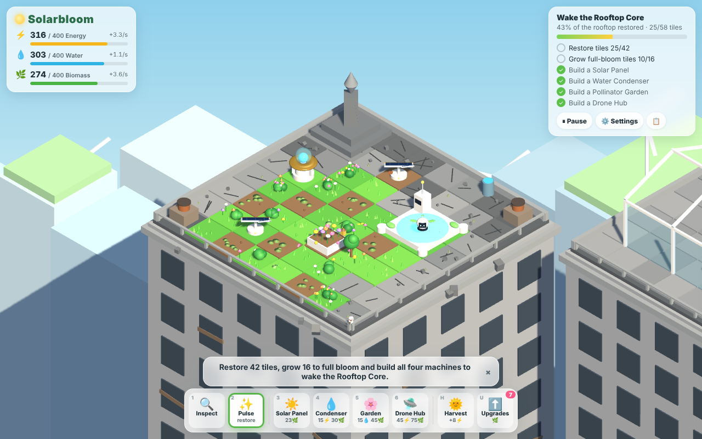

# Solarbloom

A cozy solarpunk restoration game for the browser. You start with a grey, cracked rooftop and a single damaged solar panel. You pulse tiles back to life, grow them into wildflowers and shrubs, and build machines that feed each other. Bloom Chains ripple across the garden. A little drone takes over the routine work. When the rooftop is alive, its ancient Core wakes and the whole building turns white and green, and a bridge opens to the next rooftop.

Built with **PlayCanvas Engine 2 + TypeScript + Vite**. The isometric camera is orthographic, and the world is a logical square grid rendered in 3D. All art is procedural primitives; there are no asset files.



## Run it

```bash
npm install
npm run dev        # http://localhost:5173
npm test           # unit tests (vitest)
npm run test:e2e   # pointer→tile picking at 3 screen sizes × 3 zooms (needs Playwright + Chromium)
npm run build      # type-check + production build into dist/
npm run preview    # serve the production build
```

Node 20+ is required. The build is a static site (`base: './'`), so `dist/` can be hosted anywhere.

## Controls

| Action | Mouse / keyboard | Touch |
|---|---|---|
| Restore a tile (or nurture a green one) | Left-click with **Pulse** (2) | Tap |
| Build a machine | Pick it in the hotbar (3–6), then click | Tap 🔨 Build, pick a machine, then tap |
| Inspect a machine | Click it, or use **Inspect** (1) | Tap it |
| Pan | Drag the world (or middle/right drag) | Drag |
| Zoom | Mouse wheel, `+` / `-` | Pinch |
| Harvest sunlight (emergency energy) | `H` | 🌞 button |
| Upgrades | `U` | ⬆️ button |
| Pause | `P` | ⏸ chip |
| Game speed 1× / 2× / 3× | `1×` chip | `1×` chip |
| Lucky Cat discoveries | 🐱 chip (after your first cat) | 🐱 chip |
| Cancel, close or deselect | `Esc` | Tap empty space |
| Debug / FPS overlay | `F3` or `` ` `` | Settings |

## How it plays

- **Pulse** a cracked concrete tile. It sprouts, and a moment later it is grass. Restoring a tile softens its neighbours into **mossy soil**, which is cheaper. Tap a green tile again to **nurture** it: grass → wildflowers → full bloom (shrubs, little trees, sunflowers, lavender).
- **Machines** connect automatically (no cables or pipes):
  - ☀️ **Solar Panel**: energy. When a tile right next to it blooms, it bursts (+⚡ now, ×2 for 5 s), once per chain.
  - 💧 **Water Condenser**: water, plus a charge meter. When full, it waters the dry soil beside it into bloom, starting a chain.
  - 🌸 **Pollinator Garden**: when a plant right next to it is restored or grows, it pollinates its other neighbours (up to 4 per chain). Line gardens and panels up and the chain jumps between them.
  - 🛸 **Drone Hub (2×2)**: drones restore tiles in range, then nurture them toward full bloom. Click a drone to see its range and current job.
  - 🌳 **Mother Tree (2×2)**: every restoration or new bloom within 2 tiles charges it. At full charge it releases a Bloom Pulse over the whole area. Its own pulse can't recharge it.
- **Bloom Chains** run on a deterministic event queue: you see waves spread outward from a gold-outlined origin tile, a `BLOOM CHAIN ×N` counter, and the totals at the end. Milestones at ×5 / ×10 / ×20 add +10% / +25% / +50% (highest only), and the 100-event cap fast-forwards the rest.
- **Upgrades** come in four groups. Pulse: Efficient, Wide Pulse, Overcharge. Machines: Solar Array, Rich Soil, Water Bloom, Pollinator Reach, Mother Tree Resonance. Drones: Dash, Work Radius, Chain Intelligence, Second Drone. Storage: Seed Vault, which gates the big machines.
- 🐱 **Hidden Lucky Cat**: a little maneki-neko first appears 4–6 minutes in, hidden somewhere in the scenery (12 spots, including the service ledge). Nothing points at it. Click it for Lucky Harvest, Solar Frenzy, Mega Bloom, Drone Party or a two-reward Jackpot. If you miss one, it saves up extra rewards instead of blocking new ones.
- **The rooftop transforms** as you restore it. At 25%, moss and wildflowers creep over the ledge and the concrete looks cleaner. At 50%, a solar array unfolds on the stairwell roof, planters bloom and ivy hangs from the rails. At 75%, the facade brightens and balconies and vines fill in. At 100% you awaken the **Rooftop Core**, which plays the building-wide restoration and reveals Greenhouse Tower across a new bridge.

A first session takes about 13–15 minutes (see PROGRESS.md for the pacing data).

## Architecture

```
src/
  main.ts                 boot
  app/Game.ts             glue: PlayCanvas app, fixed-step loop, input → tools, events → VFX/sound/HUD, autosave
  app/EventBus.ts         typed event bus (tile.restored, chain.step, cat.found, rooftop.coreRestored, …)
  app/SaveService.ts      versioned localStorage save
  core/                   pure data + math: types, Grid (lookups, footprints, world↔cell), Economy (caps, never negative), Rng, GameState factory
  gameplay/               headless, deterministic systems; no rendering imports
    Sim.ts                owns the state and steps every system on a fixed 0.1 s tick
    RestorationSystem     pulse validation and costs, growth timers, nurture, seeping
    BloomChainSystem      typed event queue (RESTORE/GROW/POLLINATE/PRODUCE_*/CHARGE/DISCHARGE/REWARD), caps, fast-forward
    Metrics               playtest timings saved with the game (Settings → Playtest timings)
    BuildSystem           placement rules, footprints, scaling costs
    ProductionSystem      cached rates, solar boosts, condenser irrigation
    DroneSystem           job search, tile reservation, flight, cost paying, idling
    LuckyCatSystem        anchors, visibility veto, seeded reward rolls, claim-once
    UpgradeSystem / ProgressionSystem (Core requirements, tutorial steps)
  data/                   every balance knob: tuning.ts, machines.ts, upgrades.ts, rooftops.ts (layouts + cat anchors)
  rendering/              PlayCanvas only; listens to state and never decides rules
    SceneBuilder          lights, fog, building + service ledge, Rooftop 2, bridge, stage changes, Core sequence
    Scenery               layered hazy city, foreground terraces, ledge props, stage-driven greenery
    TileFx                boosted-tile glow, chain waves, origin/job outlines
    GridRenderer          per-tile slabs + procedural decoration, squash/grow animations
    MachineVisuals, DroneVisuals, CatVisuals, Vfx (pooled rings/particles/arcs), Overlays (hover frame, ghost, radius)
    CameraController      fixed 45°/35° orthographic camera, bounded pan, smooth zoom, cinematic focus
    InputController       pointer/touch/pinch on the canvas only, click-vs-drag threshold
  ui/                     DOM HUD (Hud.ts, styles.css) and pooled flying "+2🌿" numbers
  audio/Sfx.ts            WebAudio-synthesised effects and a small generative pad (no audio files)
tests/                    vitest: grid, economy, placement, chains, drones, lucky cat, save, scripted session
```

### Design decisions

- **Game state is separate from rendering.** The `Sim` runs headless in tests. The renderer only reacts to events and reads state, so picking, coordinates and occupancy never depend on meshes.
- **Ground and occupancy are separate fields.** A machine sits on a restored tile without erasing its restoration record (`ground`, `bloom`, `pollution` and `occupantId` are independent).
- **Chains are queued, never recursive.** Each step is scheduled 0.15 s later, which also drives the visible cause → effect arcs. Solar boosts are terminal, so a solar → pulse → solar loop can't happen.
- **No softlock.** The starter panel and the rain barrel always produce, Harvest Sunlight is always available, and costs can never push a balance below zero.
- **Picking** casts a camera ray against each rooftop's slab plane and floors the hit into a cell. Cat clicks use a screen-space radius (at least 26 px) instead of the tiny mesh.
- **Performance.** World geometry uses a static batch group and tiles use a dynamic one, which takes the scene from about 1,000 draw calls to about 140–300. Materials are cached and VFX entities are pooled. Shadows come from one directional light with one cascade.
- **Saves.** The game autosaves every 10 s and on key events (machine built, upgrade, cat spawned/found, Core). A Lucky Cat claim clears the cat *before* paying out, so reloading can't pay twice. Offline progress is deliberately not simulated.

While building, a faint tile grid appears, and the placement ghost shows its outline and range. Placing a machine plays three beats: the foundation pops up, the white shell unfolds, then its light switches on. Butterflies drift between restored tiles, more of them as the garden grows. The 🐱 discovery panel (in Settings, or the 🐱 chip) lists which nooks you've found cats in and which rewards you've had.

## Limitations and next steps

- Rooftop 2 is a visual preview behind the bridge and is not playable yet (M7).
- Mother Tree, Energy Relay and multi-roof synergies are not built yet (stretch goals).
- Art is primitive-based. Rounded custom meshes, instancing and decor LOD would come next.
- Balance has been checked by a scripted bot, not by human playtests. `src/data/tuning.ts` is the place to adjust it.
- No camera rotation (out of scope for the MVP).


