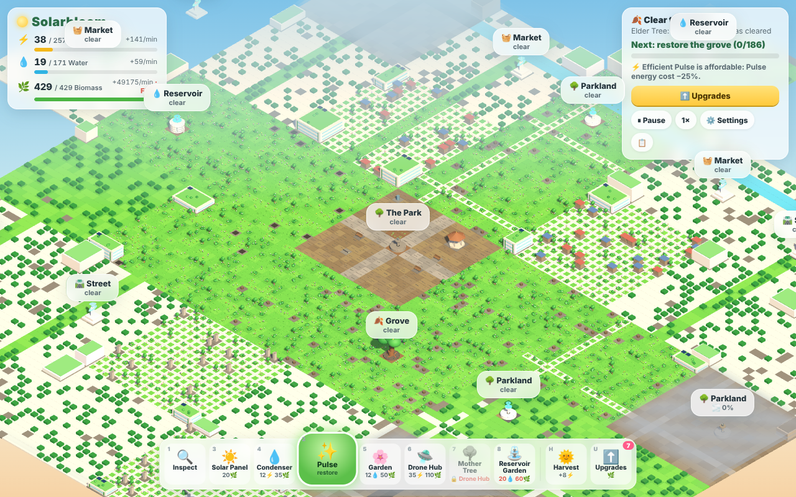

# Solarbloom

A cozy solarpunk restoration game for the browser, set in an endless city lost in a gloomy fog. You start in a dead, grey park with a dry fountain and one old solar lamp. Pulse the ground back to life, build machines that feed each other and set off Bloom Chains. Wake the fountain and the fog starts to roll back: every area you restore reveals the ones around it, forever outward, so your blooming systems can grow as big as you like.

Built with **PlayCanvas Engine 2 + TypeScript + Vite**. The camera is a perspective view that changes with the zoom (a low, wide three-quarter view close up with a sky and a distant skyline; near-isometric for the city overview), and the world is a logical square grid rendered in 3D. All art is procedural primitives and all sound is synthesised; there are no asset files.




## Run it

```bash
npm install
npm run dev                # http://localhost:5173
npm run build              # type-check + production build into dist/
npm run preview            # serve the production build
```

Node 20+ is required. The build is a static site (`base: './'`), so `dist/` can be hosted anywhere.

### Every npm script

| Script | What it does | Time |
|---|---|---|
| `npm run dev` | Vite dev server with hot reload | — |
| `npm run build` | Type-check, then production build into `dist/` | ~10 s |
| `npm run preview` | Serve `dist/` | — |
| `npm run typecheck` | `tsc --noEmit` | ~5 s |
| `npm test` | Quick check that the game works: a smoke test (new game, pulses, a drone hub, three minutes of play, save and reload) plus the fast unit tests. The list is `QUICK` in `vite.config.ts` | ~10 s |
| `npm run test:full` | Every unit and simulation test (vitest, headless): world, saves, areas, generator, chains, drones, cat, economy curves, pacing bots | several min |
| `npm run test:perf` | Node benchmarks: lookups, save size and speed, sim step for a ~1,000-area world (`tests/perf/*.perf.ts`) | ~10 s |
| `npm run test:soak` | Headless soak: a 1,000-area city over 6 h of game time; fails on tick time, heap, save size, stalls, unreachable frontiers or non-determinism (`SOAK_AREAS`, `SOAK_HOURS`, `SOAK_PROFILE=1`) | ~1 min |
| `npm run test:e2e` | Build, then check pointer → tile picking at 3 screen sizes × 3 zooms (55k checks), that the area panel opens from labels and landmarks, that every cleared area on the overview is one label tap away, that a district bloom pays once, leaves machines alone and replays for free, and that no HUD panels overlap on phone or desktop at any zoom (screenshots to `docs/review/hud-*.png`) | ~5 min |
| `npm run test:perf:browser` | Build, then load a 150-area save in Chromium, pan, zoom through every band, catch up 5 minutes away and play a ×600 chain; gates update time, hitches, draw calls, catch-up simulation time per frame and reload time (`PERF_AREAS`, `PERF_JSON`, `PERF_VERBOSE=1`) | ~4 min |
| `npm run shots:park` | Build, then render the park at each art stage (0, 25, 50, 75%, fountain awake) into `docs/review/park-stage-*.png` | ~1 min |
| `npm run shots:rooftops` | Build, then find a rooftop cluster, screenshot it out of reach, reach it with a Bloom Relay and restore part of it (fails if that doesn't work) into `docs/review/rooftop-cluster-*.png` | ~1 min |
| `npm run shots:city` | Build, then render the city overview and a close-up of a cleared area of every type into `docs/review/` for visual review | ~2 min |
| `npm run test:hud` | Build, then check the HUD at 320–430 px, phone landscape, tablet and desktop: no overlaps, Build tray on screen | ~2 min |
| `npm run test:session` | Build, then play 15 minutes in the real page (taps, builds, upgrades, Frenzy, cats); fails on any page error | ~4 min |
| `npm run shots:phase4` | Build, then before/after park screenshots (fresh, half, grown with Radiant tiles, Frenzy) into `docs/review/` | ~2 min |
| `npm run test:leak` | Build, then pan back and forth across a big city for 10 minutes; entities, materials, GPU memory and heap must return to baseline (`LEAK_MINUTES`) | ~12 min |

The browser scripts need Playwright with Chromium (`npm i -D playwright && npx playwright install chromium`) and run headless with software rendering, as in CI. GitHub Actions (`.github/workflows/ci.yml`) only builds (typecheck and production bundle, uploaded as `solarbloom-dist`) on pushes to `main` and pull requests. All tests run locally with the commands above.

## Controls

You play as **bloombot**, a little robot who restores the park and city with its own hands
(docs/BLOOMBOT_EPIC.md). Everything acts on the tile in front of bloombot, which is highlighted. Keys can be
rebound in Settings → Controls.

| Action | Keyboard and mouse | Gamepad |
|---|---|---|
| Move | `W` `A` `S` `D` or the arrows; click a tile to walk there and use the tool | Left stick |
| Sprint | `Shift` | Right trigger |
| Pulse the tile in front (or build there with a build tool) | `E` | A |
| Interact: inspect, wake a landmark, greet a Lucky Cat, ride a rooftop lift | `Q` | X |
| Build tray | `B` (machines on `3`–`9` and `0`) | Y |
| Cancel, close or deselect | `Esc` | B |
| Harvest sunlight (emergency energy) | `F` | D-pad left |
| Upgrades | `U` | D-pad right |
| Backpack (discoveries) | `Tab` | D-pad up |
| Previous / next tool | `1` / `2` | Bumpers |
| Zoom, only while placing something (the camera pulls back by itself; in play its distance is fixed) | Mouse wheel, `+` / `-` | Right stick up / down |
| Turn the view around bloombot | Drag with the right mouse button | Right stick left / right |
| Recentre the view | `C` | Right stick click |
| Overview (and back) | `M`; in the overview, click a woken landmark to travel there | View |
| Settings / pause | `P` | Menu |
| Bloom Frenzy (when full) | `R` | Left trigger |
| Go to the area that needs you (camera only) | `N` | Left stick click |
| Back to the park (camera only) | `Home` | |
| Debug / FPS overlay | `F3` or `` ` `` | |

Phones and tablets aren't supported for now. `?cursor=1` brings back the old click-to-act play (used by
some end-to-end tests).

Switching to another tab doesn't stop the city: when you come back, up to 10 minutes are caught up over a few frames (Pause still pauses).

**Away for longer, or closed the game?** Your garden keeps growing at half pace for up to 4 hours: steady production and drone work only. Landmarks, Lucky Cats, chains and milestones wait for you, and nothing is lost by staying away. A small "Welcome back" note shows what came in and anything that didn't fit in storage.

### Dev tools (Phase 4)

On the dev server only (`npm run dev`), the browser console has `sbDev`: `sbDev.reset(seed)`, `sbDev.preset('fresh' | 'screenshot' | 'rich')`, `sbDev.simulate(seconds)`, `sbDev.log()` (the local event log), `sbDev.counts()`, `sbDev.overflow()` (income lost to full storage) and `sbDev.face(name)` (show one drone expression on every drone: `idle`, `focused`, `excited`, `workingA`, `workingB`, `restoring`, `sleeping`, `blink`; no argument to go back). None of it ships in `npm run build`. The scripted first-15-minute baseline is `npx vitest run tests/baseline.test.ts` (`BASELINE=1` for per-minute detail), and the phone HUD check is `node tests/e2e/phase4-hud.e2e.mjs` after a build. Phase 4 plan and status: `docs/PHASE_4_EPICS.md`, `docs/PHASE_4_AUDIT.md`.

## Branches and releases

- **`testing`** is where work lands: branch from it and open pull requests into it.
- **`main`** is what has been released. Merge `testing` into `main` to release.
- Every push to `main` runs the **Steam Deck release** workflow (`.github/workflows/release-steamdeck.yml`): it
  builds the game, wraps it with Electron as a Linux AppImage and publishes a GitHub release named
  `v<version>-build.<run>`. It can also be run by hand from the Actions tab.
- On a Steam Deck: see `docs/STEAM_DECK.md` (install script, the Deck graphics preset, file saves and the
  test checklist).
- Locally: `npm run desktop` opens the built game in an Electron window, and `npm run package:deck` builds the
  AppImage into `release/` (Linux only).

## How it plays

### The park

You start in the **dilapidated park**: 242 restorable tiles of dead lawn and cracked paths around a dry fountain, a bandstand and benches, with fog all around.

- An **old drone** lives by the old solar lamp. It slowly restores and nurtures the tiles around the lamp for free; your taps are much faster.
- **Pulse** a dead tile. It sprouts, and a moment later it is grass. Restoring a tile softens its neighbours into **mossy soil**, which is cheaper. Tap a green tile again to **nurture** it: grass → wildflowers → full bloom.
- **Machines** connect automatically (no cables or pipes):
  - ☀️ **Solar Panel**: energy. When a tile right next to it blooms, it bursts (+⚡ now, ×2 for 5 s), once per chain.
  - 💧 **Water Condenser**: water, plus a charge meter. When full, it waters the dry soil beside it into bloom, starting a chain.
  - 🌸 **Pollinator Garden**: when a plant next to it is restored or grows, it pollinates its neighbours. On a road or paving it is a **street garden**, and passes the chain to the next street garden within 6 tiles: a **green corridor**.
  - 🛸 **Drone Hub (2×2)**: drones restore tiles within 6 tiles, then nurture them, paying the usual pulse cost. They never spend the last quarter of a store, so your own taps always have something left. Hubs within 12 tiles link into a network, and drones prefer the fog edge.
  - 🌳 **Mother Tree (2×2)**: blooms within 2 tiles charge it; at full charge it releases a Bloom Pulse over the whole area.
  - ⛲ **Reservoir Garden** (reservoir and canal areas only): fills from nearby condensers and overflows into lush bloom.
- **Bloom Chains** run on a deterministic event queue: waves spread outward from a gold-outlined origin, a `BLOOM CHAIN ×N` counter climbs, and the totals show at the end. A chain can run up to 1,500 events and 20 s of travel in the city before the rest resolves at once.
- **Storage** grows in tiers with the 🏺 Seed Vault (🌿 100 → 250 → 600 → 1,500 → 4,000; ⚡ and 💧 likewise). Everything the fountain needs fits in the starting stores.
- Restore 130 tiles and bring 52 to full bloom, then **wake the fountain** (40 ⚡ + 100 🌿, about 6 minutes in for the scripted player). The park's fog lifts and the first ring of areas appears.

### The endless city

The city is generated forever outward from the park: the same seed always gives the same city, whatever order you explore it in.

- **Areas.** The world is split into areas of about 2–4 chunks (16×16 tiles each). Each has a type, a landmark and a permanent bonus once cleared:

| Type | Ground | Landmark | Bonus per cleared area* |
|---|---|---|---|
| 🌳 Park | lawn | Dry Fountain | +0.3 🌿/s |
| 🛣️ Street | paving | Signal Mast | +0.25 ⚡/s |
| ⛲ Plaza | paving | Clock Tower | +0.35 ⚡/s |
| 🛶 Canal | paving and water | Lock Gate | +0.35 💧/s |
| 🧺 Market | paving | Market Hall | +0.25 🌿/s, +0.1 ⚡/s |
| 💧 Reservoir | clay | Old Cistern | +0.5 💧/s |
| 🍂 Grove | leaf litter | Elder Tree | +0.4 🌿/s |
| 🏢 Rooftops | paving, with a raised rooftop | Rooftop Core (on the roof) | +0.3 ⚡/s, +0.15 🌿/s |

  \* Soft-scaled: *n* areas of a type give base × *n*^0.75, so numbers stay readable after hundreds of areas. Districts (old town, docks, towers, parkland) favour different types and building heights. Buildings stand on block corners (more in streets and markets, few in groves): grey and shuttered in the fog, white with roof gardens, solar panels and vines once their area clears. Roads and canals run through the city. Rare authored landmarks (the Great Greenhouse, the Solar Cathedral, the Sky Observatory, then one every 10 chunks) stand out on the way.

- **The fog.** Every area is in one of four states:

| State | What it means |
|---|---|
| Hidden | Deep fog, grey ground. Nothing can be touched. |
| Frontier | Revealed next to clear ground. You can restore tiles that touch clear ground, so the fog is pushed back from its edge inward. Every frontier is guaranteed a way in. |
| Thinning | You've started restoring it; the fog thins as you go (from full to a quarter). |
| Cleared | Its landmark is awake. The fog is gone, its bonus applies and its neighbours become frontiers. |

  A landmark can be woken once 60% of the area's restorable tiles are restored (at most 160 × its difficulty) **and** its specialty action for the area's type is done:

| Type | Specialty action |
|---|---|
| 🌳 Parkland | grow a few tiles to full bloom |
| 🛣️ Street | pass a chain along a green corridor (two street gardens) |
| ⛲ Plaza | boost a Solar Panel with blooms beside it |
| 🛶 Canal | send water along the canal (a garden on one bank, a condenser further along) |
| 🧺 Market | set off a big enough Bloom Chain here |
| 💧 Reservoir | overflow a Reservoir Garden |
| 🍂 Grove | release a Canopy Burst from the Elder Tree |
| 🏢 Rooftops | reach the roof with a Bloom Relay and restore part of it |

  Sizes grow a little with distance (capped). The objective panel, the area panel and the suggestion button all show the next step. An area whose layout can't host its type's action asks for full blooms instead, and a fogged area that is entirely in full bloom never waits on its specialty.

- **Difficulty grows with distance.** Pulse costs rise 4% per chunk from the park (up to ×2), and outer areas start more polluted.
- **The economy keeps up.** Each cleared area raises storage (+35% of the starting caps each, with diminishing returns) and waives one step of the ×1.5 cost growth for every machine type. A bot playing the city clears 26–31 areas an hour with no dead time, specialty actions included.
- **Specialties travel.** Grove landmarks are Elder Trees: blooms around them charge a Canopy Burst. Reservoir and canal areas grow Reservoir Gardens.
- **Rooftop clusters.** A few streets, plazas and markets (2+ blocks out) are Rooftops instead: an old building carries a raised roof laid out like one of the original rooftops (the Seed, the Reservoir or the Canopy, with their concrete, clay and leaf-litter looks), and its Rooftop Core is the area's landmark. The roof stays grey and out of reach until a Bloom Relay on the ground comes within range; then it's playable like any ground, and relays link across.
- **Bloom Relays** (📡, after a Drone Hub). Any two relays within 16 tiles link up. A bloom beside one sends a pulse to each linked relay, blooming the ground there, and the far relay can pass it on: once per link per chain, then a 6 s recharge. Relay Lens reaches further and blooms more.
- **Canal water networks.** Restored canal water carries flow. Water Condensers and Reservoir Gardens built beside clean water join that canal's network: a condenser with no garden beside it fills the emptiest basin on its canal, and an overflowing basin also spills at the connected garden with the most dry ground (once per chain). The water visibly runs along the canal.
- **Overcharge.** A manual pulse right next to a machine boosts its next trigger (a cyan ring shows it), by more with each Overcharge upgrade level. Automation never does.
- **Mega Pulse.** Once the fountain is awake, every manual pulse charges the meter on the Pulse button. After 40 taps it glows, and your next pulse sets off a city-scale bloom from that tile (40 tiles, +3 per cleared area, up to 300). Your own taps start most of the big chains.
- **The Lucky Cat** hides in nooks beside obstacles in cleared areas (and around the park early on). Nothing points at it. Rewards: Lucky Harvest, Solar Surge (solar ×3 for a while), Mega Bloom, Drone Party, Jackpot, **Golden Relay** (the next green corridor hop blooms 5 extra tiles), **Cat's Garden** (a little garden blooms in one of your cleared areas) and **Fog Whisker** (the next fogged area thins from its edge). No reward ever touches the fog. If you miss a cat, it saves up extra rewards instead of blocking new ones.
- **District blooms.** The city is divided into districts (Old Town, the Docks, the Towers, the Parklands; an area belongs to the district its landmark stands in). Once 4 neighbouring landmarks in a district are awake, its **district bloom** is ready (a toast, the objective panel and every one of its area panels offer it). It's a one-time reward: resources (a little more for each district you've bloomed) and every free tile of its cleared areas grows lusher. Your machines are never touched. The presentation is skippable, and the area panel can replay it for free.
- **Area switches.** Each area's panel has four drone switches: Normal, 🌸 Keep blooming (its green tiles come first), 🌫️ Focus the frontier (drones from its hubs push hard into the fog) and ✋ Leave alone (drones skip it). No routing or logistics.
- **The camera** zooms out to a city overview with a far level of detail and area labels; `F` jumps to the next area that needs you.

## Architecture

```
src/
  main.ts                 boot (async save load)
  app/Game.ts             glue: PlayCanvas app, fixed-step loop, input → tools, events → VFX/sound/HUD, autosave
  app/EventBus.ts         typed event bus (tile.restored, chain.event, area.cleared, cat.found, …)
  app/SaveService.ts      save v4: per-chunk deltas, gzip + base64, async; older saves discarded with a notice
  core/
    Grid                  the world: layers of 16×16 chunks generated on demand; O(r²) tile and machine lookups
    Hash / Generation     order-independent generation from a hash of (seed, layer, x, z); the park layout
    Areas                 jittered Voronoi of chunks into areas: type, theme, difficulty, landmark, neighbours
    TilePack              save encoding: per-chunk columns of changes from generation
    GameState, Economy, Rng, types
  gameplay/               headless, deterministic systems; no rendering imports
    Sim                   owns the state and steps every system on a fixed 0.1 s tick
    AreaSystem            fog states, the edge rule, wake requirements, reveals, bonuses, storage, reachability
    RestorationSystem     pulse validation and costs (with distance difficulty), growth timers, nurture, seeping
    BloomChainSystem      priority-queue chains (RESTORE/GROW/POLLINATE/CORRIDOR/PRODUCE_*/CHARGE/OVERFLOW/CANOPY_BURST/LUSH/…), caps, fast-forward
    ProductionSystem      per-chunk cached rates, re-summed only near changes; area bonus income
    DroneSystem           hub networks, fog-edge job search, reservations, flight
    LuckyCatSystem        generated nooks, spawn rules, seeded rewards, claim-once
    RooftopClusters       generated city rooftops: roof layers, reach by relays, roof counts
    RelaySystem           Bloom Relay links (range in world space), recharge, crossings
    CanalNetwork          canal water networks: clean water tiles linking condensers and Reservoir Gardens, routing, paths
    Milestones            area milestone generator: each landmark's specialty action, layout checks, progress, canal plans
    DistrictSystem        district membership, district bloom availability, claim-once reward and replays
    BuildSystem, UpgradeSystem, ProgressionSystem, Metrics
  data/                   every balance knob: tuning.ts (TUNING.city, TUNING.park, …), city.ts (area types, park layout, generator), machines.ts, upgrades.ts
  rendering/              PlayCanvas only; listens to state and never decides rules
    ChunkRenderer         streams merged vertex-coloured chunk meshes and fog sheets around the camera, far LOD
    MachineVisuals        machines (merged into per-region dynamic batches) and landmarks; only on-screen ones animate. DroneVisuals, CatVisuals, Vfx, Overlays
    CameraController      zoom-dependent perspective camera (45° yaw), ground-anchored pan, zoom to the cursor, edge-aware bounds, glide, onScreen() for world-anchored UI
    Sky, Skyline          sky dome, sun and clouds; three rings of procedural terraced towers (colours in data/sky.ts)
    SceneBuilder, Scenery, InputController
  ui/                     DOM HUD (Hud.ts, styles.css) and pooled flying "+2🌿" numbers
  audio/Sfx.ts            WebAudio-synthesised effects and a small generative pad
tests/                    vitest suites, perf/ (benchmarks, browser perf, leak), soak/, e2e/ (picking)
```

### Design decisions

- **Game state is separate from rendering.** The `Sim` runs headless in tests, soaks and bots. The renderer only reacts to events and reads state.
- **Generation is a pure function.** A tile is a hash of (seed, layer, x, z), so the city never depends on visiting order, and saves only store what you changed.
- **Everything nearby is O(1) in world size.** Lookups go through chunks and a per-chunk machine index; growing tiles, production and fog counts are cached and updated incrementally.
- **The fog moves from its edge.** Only tiles touching clear ground can change, so restoration always reads as pushing the fog back, and every revealed area is guaranteed an entry.
- **Chains are queued, never recursive,** and capped, so even a ×600 chain across a dozen areas terminates and pays once.
- **No softlock.** Every purchase the fountain needs fits in the starting stores (with room to spare for energy and water, which drones spend). The starter panel and rain barrel always produce, Harvest Sunlight is always available, costs can't push a balance below zero, overflow always fires and the Elder Tree self-charges.
- **Saves are small and safe.** Autosave every 10 s (gzip at an idle moment; page unload saves plainly). A 1,000-area city stores in about 0.6 MB. Lucky Cat claims and one-time unlocks are marked before paying out, so reloading can't pay twice. Every save stamps the time it was written; time away earns bounded offline progress (`OfflineSystem`: half rate, 4 h cap, no one-time rewards, no chains), and the result is saved at once so a reload can't count it twice.

## Limitations

- Chunk meshes are dense: about 2 MB of GPU memory per streamed chunk at near zoom.
- Balance has been checked by scripted bots, not human playtests. `src/data/tuning.ts` and `src/data/city.ts` are the places to adjust it.
- Real-device performance numbers are still to be logged (#99). No camera rotation.

See [PROGRESS.md](PROGRESS.md) for the status of every part of the city epic (#1), measured numbers and pacing data.
