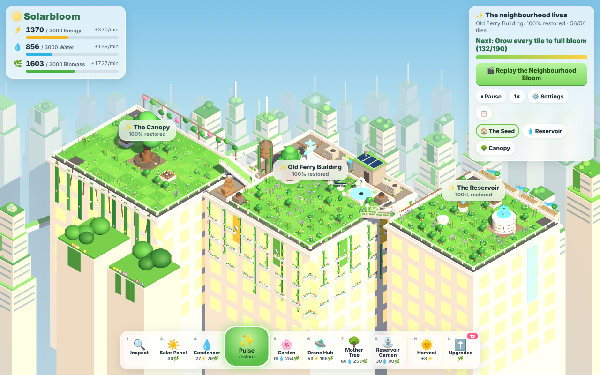
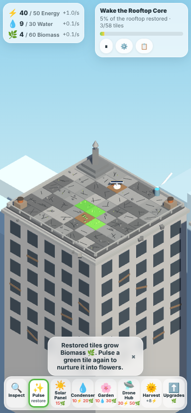

# Solarbloom

A cozy solarpunk restoration game for the browser. You start with a grey, cracked rooftop and a single damaged solar panel. You pulse tiles back to life, grow them into wildflowers and shrubs, and build machines that feed each other. Bloom Chains ripple across the garden. A little drone takes over the routine work. When the rooftop is alive, its ancient Core wakes and the whole building turns white and green.

Then the neighbourhood opens up. Build the Skybridge Relay to reach **the Reservoir**, a dry basin around an old cistern. Make it overflow and the **Canopy Bridge** leads to **the Canopy**, an overgrown roof with a dormant Elder Tree. Relay pylons carry Bloom Chains across the bridges, so a well-placed pulse on one rooftop makes another one bloom. Wake all three rooftops for the **Neighbourhood Bloom**.

Built with **PlayCanvas Engine 2 + TypeScript + Vite**. The isometric camera is orthographic, and the world is a logical square grid rendered in 3D. All art is procedural primitives; there are no asset files.



## Run it

```bash
npm install
npm run dev        # http://localhost:5173
npm test           # unit tests (vitest)
npm run test:e2e   # pointer→tile picking at 3 screen sizes × 3 zooms (needs Playwright + Chromium)
npm run build      # type-check + production build into dist/
npm run preview    # serve the production build
```

Node 20+ is required. The build is a static site (`base: './'`), so `dist/` can be hosted anywhere.

## Controls

| Action | Mouse / keyboard | Touch |
|---|---|---|
| Restore a tile (or nurture a green one) | Left-click with **Pulse** (2) | Tap |
| Build a machine | Pick it in the hotbar (3–8), then click | Tap 🔨 Build, pick a machine, then tap |
| Focus a rooftop | `F` cycles rooftops, or the rooftop chips under the objective | Rooftop chips |
| Build a bridge / wake a rooftop | The objective panel button, or the button over the dashed bridge | Same |
| Inspect a machine | Click it, or use **Inspect** (1) | Tap it |
| Pan | Drag the world (or middle/right drag) | Drag |
| Zoom | Mouse wheel, `+` / `-` | Pinch |
| Harvest sunlight (emergency energy) | `H` | 🌞 button |
| Upgrades | `U` | ⬆️ button |
| Pause | `P` | ⏸ chip |
| Game speed 1× / 2× / 3× | `1×` chip | `1×` chip |
| Lucky Cat discoveries | 🐱 chip (after your first cat) | 🐱 chip |
| Cancel, close or deselect | `Esc` | Tap empty space |
| Debug / FPS overlay | `F3` or `` ` `` | Settings |

## How it plays

### The first rooftop (Rounds 1–2)

- **Pulse** a cracked concrete tile. It sprouts, and a moment later it is grass. Restoring a tile softens its neighbours into **mossy soil**, which is cheaper. Tap a green tile again to **nurture** it: grass → wildflowers → full bloom (shrubs, little trees, sunflowers, lavender).
- **Machines** connect automatically (no cables or pipes):
  - ☀️ **Solar Panel**: energy. When a tile right next to it blooms, it bursts (+⚡ now, ×2 for 5 s), once per chain.
  - 💧 **Water Condenser**: water, plus a charge meter. When full, it waters the dry soil beside it into bloom, starting a chain.
  - 🌸 **Pollinator Garden**: when a plant right next to it is restored or grows, it pollinates its other neighbours (up to 4 per chain). Line gardens and panels up and the chain jumps between them.
  - 🛸 **Drone Hub (2×2)**: drones restore tiles in range, then nurture them toward full bloom. Click a drone to see its range and current job.
  - 🌳 **Mother Tree (2×2)**: every restoration or new bloom within 2 tiles charges it. At full charge it releases a Bloom Pulse over the whole area. Its own pulse can't recharge it.
- **Bloom Chains** run on a deterministic event queue: you see waves spread outward from a gold-outlined origin tile, a `BLOOM CHAIN ×N` counter, and the totals at the end. Milestones at ×5 / ×10 / ×20 add +10% / +25% / +50% (highest only), and the 100-event cap fast-forwards the rest.
- **Upgrades** come in four groups. Pulse: Efficient, Wide Pulse, Overcharge. Machines: Solar Array, Rich Soil, Water Bloom, Pollinator Reach, Mother Tree Resonance. Drones: Dash, Work Radius, Chain Intelligence, Second Drone. Storage: Seed Vault, which gates the big machines.
- 🐱 **Hidden Lucky Cat**: a little maneki-neko first appears 4–6 minutes in, hidden somewhere in the scenery (12 spots, including the service ledge). Nothing points at it. Click it for Lucky Harvest, Solar Frenzy, Mega Bloom, Drone Party or a two-reward Jackpot. If you miss one, it saves up extra rewards instead of blocking new ones.
- **The rooftop transforms** as you restore it. At 25%, moss and wildflowers creep over the ledge and the concrete looks cleaner. At 50%, a solar array unfolds on the stairwell roof, planters bloom and ivy hangs from the rails. At 75%, the facade brightens and balconies and vines fill in. At 100% you awaken the **Rooftop Core**, which plays the building-wide restoration and reveals Greenhouse Tower across a new bridge.

A first session to the Seed's Core takes about 13–15 minutes (see PROGRESS.md for the pacing data).

### The neighbourhood (Phase 3)


- **Three rooftops, one grid feel.** The Seed (8×8), the Reservoir (8×8, sun-baked clay) and the Canopy (10×8, withered leaf litter). Each has its own roof-local grid, tile ids like `r2:3:5`, and the same hover, tap and build controls. Locked rooftops are visible and tell you how to reach them.
- **Bridges and relays.** After the Seed's Core wakes and the Seed is in full bloom, build the 🌉 **Skybridge Relay** (220🌿 90⚡). The bridge is the visual link and the relay pylons are the mechanical one: a chain effect on a tile right next to a pylon sends a pulse across. It travels over the bridge and blooms the best spots near the far pylon (gardens, panels and trees first), and the chain carries on over there. Each link fires at most once per chain and recharges in 8 s. Click a pylon to see `Connected: 2 roofs` and when the next cross-roof pulse is ready.
- **The Reservoir: Overflow.** ⛲ Reservoir Gardens (key 8, Reservoir only) fill whenever a Water Condenser within 2 tiles fills its meter. A full basin overflows: up to 3 dry tiles nearby burst into **lush** bloom (×2 🌿 for 25 s). Wake the 💧 **Old Cistern** (48 tiles restored, 3 Overflows) for steady water and a cascading basin.
- **The Canopy: Canopy Burst.** Blooms within 3 tiles charge the 🌳 **Elder Tree**'s ring of seed-lights. A full ring releases a Canopy Burst over 2 tiles (3 once it's awake). 🌸 Pollinator Gardens inside the burst carry it 2 blooms further. Wake the tree (64 tiles, 5 bursts).
- **Active play near machines.** A manual pulse right next to a machine boosts its next trigger: +1 target, a double solar burst, or +1 radius for trees. A cyan ring shows the boost. Automation never boosts.
- **Neighbourhood upgrades.** Relay II (2 remote blooms, 6 s recharge) and Drone Dispatch (idle drones fly over the bridges to help near the far relay).
- **Lucky Cat, everywhere.** The cat hides on any playable rooftop (never under the HUD, usually somewhere already on screen). Two new rewards: **Golden Relay** (the next crossing blooms one extra tile) and **Cat's Garden** (a little cluster blooms on a rooftop, usually a new one). It never blocks a build: build on its nook and it hops elsewhere.
- **The Neighbourhood Bloom.** With all three Cores awake, one button plays the 10-second finale: energy gathers at the Cores, relays light, green waves roll across all three rooftops, the buildings turn white, resources shower in and a new district rises on the horizon. Skippable, and replayable from the objective panel without rewards.

Two play styles work: **solar + drone** (steady throughput, many small chains) and **water + pollinator** (slower, bigger bursts). The scripted bots in `tests/pacing-hood.test.ts` finish the neighbourhood both ways.

## Architecture

```
src/
  main.ts                 boot
  app/Game.ts             glue: PlayCanvas app, fixed-step loop, input → tools, events → VFX/sound/HUD, autosave
  app/EventBus.ts         typed event bus (tile.restored, chain.step, cat.found, rooftop.coreRestored, …)
  app/SaveService.ts      versioned localStorage save
  core/                   pure data + math: types, Grid (lookups, footprints, world↔cell), Economy (caps, never negative), Rng, GameState factory
  gameplay/               headless, deterministic systems; no rendering imports
    NeighbourhoodSystem   bridges/links, relay status, Reservoir and Canopy Cores, objectives, the Neighbourhood Bloom
    Sim.ts                owns the state and steps every system on a fixed 0.1 s tick
    RestorationSystem     pulse validation and costs, growth timers, nurture, seeping
    BloomChainSystem      typed event queue (RESTORE/GROW/POLLINATE/PRODUCE_*/CHARGE/DISCHARGE/RELAY/OVERFLOW/CANOPY_BURST/LUSH/REWARD), caps, fast-forward
    Metrics               playtest timings saved with the game (Settings → Playtest timings)
    BuildSystem           placement rules, footprints, scaling costs
    ProductionSystem      cached rates, solar boosts, condenser irrigation
    DroneSystem           job search, tile reservation, flight, cost paying, idling
    LuckyCatSystem        anchors, visibility veto, seeded reward rolls, claim-once
    UpgradeSystem / ProgressionSystem (Core requirements, tutorial steps)
  data/                   every balance knob: tuning.ts (Phase 3 under TUNING.neighbourhood), machines.ts, upgrades.ts, rooftops.ts (layouts, links, cat anchors)
  rendering/              PlayCanvas only; listens to state and never decides rules
    SceneBuilder          lights, fog, building + service ledge, Rooftop 2, bridge, stage changes, Core sequence
    Scenery               layered hazy city, foreground terraces, ledge props, stage-driven greenery
    TileFx                boosted-tile glow, chain waves, origin/job outlines
    GridRenderer          per-tile slabs + procedural decoration, squash/grow animations
    MachineVisuals, DroneVisuals, CatVisuals, Vfx (pooled rings/particles/arcs), Overlays (hover frame, ghost, radius)
    CameraController      fixed 45°/35° orthographic camera, bounded pan, smooth zoom, cinematic focus
    InputController       pointer/touch/pinch on the canvas only, click-vs-drag threshold
  ui/                     DOM HUD (Hud.ts, styles.css) and pooled flying "+2🌿" numbers
  audio/Sfx.ts            WebAudio-synthesised effects and a small generative pad (no audio files)
tests/                    vitest: grid, economy, placement, chains, drones, lucky cat, save, scripted sessions,
                          Phase 3: save migration (real Round 2 saves in tests/fixtures), relays, specialties,
                          neighbourhood flow, multi-roof cat, neighbourhood pacing bots
```

### Design decisions

- **Game state is separate from rendering.** The `Sim` runs headless in tests. The renderer only reacts to events and reads state, so picking, coordinates and occupancy never depend on meshes.
- **Ground and occupancy are separate fields.** A machine sits on a restored tile without erasing its restoration record (`ground`, `bloom`, `pollution` and `occupantId` are independent).
- **Chains are queued, never recursive.** Each step is scheduled 0.15 s later, which also drives the visible cause → effect arcs. Solar boosts are terminal, so a solar → pulse → solar loop can't happen.
- **No softlock.** The starter panel and the rain barrel always produce, Harvest Sunlight is always available, and costs can never push a balance below zero.
- **Picking** casts a camera ray against each rooftop's slab plane and floors the hit into a cell. Cat clicks use a screen-space radius (at least 26 px) instead of the tiny mesh.
- **Performance.** World geometry uses a static batch group and tiles use a dynamic one, which takes the scene from about 1,000 draw calls to about 140–300. Materials are cached and VFX entities are pooled. Shadows come from one directional light with one cascade.
- **Saves.** The game autosaves every 10 s and on key events (machine built, upgrade, cat spawned/found, Core, bridge, Neighbourhood Bloom). A Lucky Cat claim clears the cat *before* paying out, and one-time unlocks are marked claimed before anything is paid, so reloading can't pay twice. Offline progress is deliberately not simulated. Save format v3 migrates Round 1 and Round 2 saves; the Seed is kept tile for tile.
- **Cross-roof links are explicit.** Rooftops never become adjacent by world position. A chain only crosses at a built link's relay zone, at most once per link per chain, on a recharge. Relay loops can't retrigger themselves.
- **No stalls.** Overflow always fires when a basin is full (watering green tiles or just splashing if nothing is dry). The Elder Tree slowly charges on its own once the Canopy is half alive. Bridge milestones are a share of the open tiles, so building more machines can never make one unreachable.

While building, a faint tile grid appears, and the placement ghost shows its outline and range. Placing a machine plays three beats: the foundation pops up, the white shell unfolds, then its light switches on. Butterflies drift between restored tiles, more of them as the garden grows. The 🐱 discovery panel (in Settings, or the 🐱 chip) lists which nooks you've found cats in and which rewards you've had.

## Limitations and next steps

- The district that appears after the Neighbourhood Bloom is a horizon silhouette, a goal for a later phase.
- Art is primitive-based. Rounded custom meshes, instancing and decor LOD would come next.
- Balance has been checked by scripted bots, not by human playtests. `src/data/tuning.ts` (`TUNING.neighbourhood`) and `src/data/rooftops.ts` are the places to adjust it.
- No camera rotation (out of scope).


