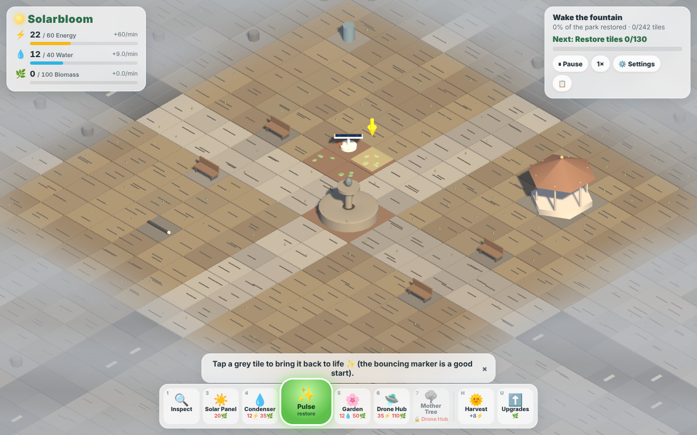

# Solarbloom

A cozy solarpunk restoration game for the browser, set in an endless city lost in a gloomy fog. You start in a dead, grey park with a dry fountain and one old solar lamp. Pulse the ground back to life, build machines that feed each other and set off Bloom Chains. Wake the fountain and the fog starts to roll back: every area you restore reveals the ones around it, forever outward, so your blooming systems can grow as big as you like.

Built with **PlayCanvas Engine 2 + TypeScript + Vite**. The isometric camera is orthographic, and the world is a logical square grid rendered in 3D. All art is procedural primitives and all sound is synthesised; there are no asset files.



## Run it

```bash
npm install
npm run dev                # http://localhost:5173
npm run build              # type-check + production build into dist/
npm run preview            # serve the production build
```

Node 20+ is required. The build is a static site (`base: './'`), so `dist/` can be hosted anywhere.

### Every npm script

| Script | What it does | Time |
|---|---|---|
| `npm run dev` | Vite dev server with hot reload | — |
| `npm run build` | Type-check, then production build into `dist/` | ~10 s |
| `npm run preview` | Serve `dist/` | — |
| `npm run typecheck` | `tsc --noEmit` | ~5 s |
| `npm test` | Unit and simulation tests (vitest, headless): world, saves, areas, generator, chains, drones, cat, pacing bots | ~1 min |
| `npm run test:perf` | Node benchmarks: lookups, save size and speed, sim step for a ~1,000-area world (`tests/perf/*.perf.ts`) | ~10 s |
| `npm run test:soak` | Headless soak: a 1,000-area city over 6 h of game time; fails on tick time, heap, save size, stalls, unreachable frontiers or non-determinism (`SOAK_AREAS`, `SOAK_HOURS`, `SOAK_PROFILE=1`) | ~1 min |
| `npm run test:e2e` | Build, then check pointer → tile picking at 3 screen sizes × 3 zooms (55k checks), and that the area panel opens from labels and landmarks | ~3 min |
| `npm run test:perf:browser` | Build, then load a 150-area save in Chromium, pan, zoom through every band and play a ×600 chain; gates update time, hitches, draw calls and reload time (`PERF_AREAS`, `PERF_JSON`, `PERF_VERBOSE=1`) | ~4 min |
| `npm run test:leak` | Build, then pan back and forth across a big city for 10 minutes; entities, materials, GPU memory and heap must return to baseline (`LEAK_MINUTES`) | ~12 min |

The browser scripts need Playwright with Chromium (`npm i -D playwright && npx playwright install chromium`) and run headless with software rendering, as in CI. CI (`.github/workflows/ci.yml`) runs the typecheck, unit tests, benchmarks, soak, browser perf and picking on every push to `main`.

## Controls

| Action | Mouse / keyboard | Touch |
|---|---|---|
| Restore a tile (or nurture a green one) | Left-click with **Pulse** (2) | Tap |
| Build a machine | Pick it in the hotbar (3–7), then click | Pick it, then tap |
| Wake a landmark | Click it when it glows, or the objective panel's button | Tap |
| Go to the area that needs you | `F` cycles areas that need attention; `Home` returns to the park | Area labels when zoomed out |
| Inspect a machine | Click it, or use **Inspect** (1) | Tap it |
| Pan | Drag the world (or middle/right drag) | Drag |
| Zoom (down to a city overview) | Mouse wheel, `+` / `-` | Pinch |
| Harvest sunlight (emergency energy) | `H` | 🌞 button |
| Upgrades | `U` | ⬆️ button |
| Pause | `P` | ⏸ chip |
| Game speed 1× / 2× / 3× | `1×` chip | `1×` chip |
| Lucky Cat discoveries | 🐱 chip (after your first cat) | 🐱 chip |
| Cancel, close or deselect | `Esc` | Tap empty space |
| Debug / FPS overlay | `F3` or `` ` `` | Settings |

## How it plays

### The park

You start in the **dilapidated park**: 242 restorable tiles of dead lawn and cracked paths around a dry fountain, a bandstand and benches, with fog all around.

- **Pulse** a dead tile. It sprouts, and a moment later it is grass. Restoring a tile softens its neighbours into **mossy soil**, which is cheaper. Tap a green tile again to **nurture** it: grass → wildflowers → full bloom.
- **Machines** connect automatically (no cables or pipes):
  - ☀️ **Solar Panel**: energy. When a tile right next to it blooms, it bursts (+⚡ now, ×2 for 5 s), once per chain.
  - 💧 **Water Condenser**: water, plus a charge meter. When full, it waters the dry soil beside it into bloom, starting a chain.
  - 🌸 **Pollinator Garden**: when a plant next to it is restored or grows, it pollinates its neighbours. On a road or paving it is a **street garden**, and passes the chain to the next street garden within 6 tiles: a **green corridor**.
  - 🛸 **Drone Hub (2×2)**: drones restore tiles in range, then nurture them. Hubs within 12 tiles link into a network, and drones prefer the fog edge.
  - 🌳 **Mother Tree (2×2)**: blooms within 2 tiles charge it; at full charge it releases a Bloom Pulse over the whole area.
  - ⛲ **Reservoir Garden** (reservoir and canal areas only): fills from nearby condensers and overflows into lush bloom.
- **Bloom Chains** run on a deterministic event queue: waves spread outward from a gold-outlined origin, a `BLOOM CHAIN ×N` counter climbs, and the totals show at the end. A chain can run up to 1,500 events and 20 s of travel in the city before the rest resolves at once.
- Restore 130 tiles and bring 52 to full bloom, then **wake the fountain** (about 6½ minutes in). The park's fog lifts and the first ring of areas appears.

### The endless city

The city is generated forever outward from the park: the same seed always gives the same city, whatever order you explore it in.

- **Areas.** The world is split into areas of about 2–4 chunks (16×16 tiles each). Each has a type, a landmark and a permanent bonus once cleared:

| Type | Ground | Landmark | Bonus per cleared area* |
|---|---|---|---|
| 🌳 Park | lawn | Dry Fountain | +0.3 🌿/s |
| 🛣️ Street | paving | Signal Mast | +0.25 ⚡/s |
| ⛲ Plaza | paving | Clock Tower | +0.35 ⚡/s |
| 🛶 Canal | paving and water | Lock Gate | +0.35 💧/s |
| 🧺 Market | paving | Market Hall | +0.25 🌿/s, +0.1 ⚡/s |
| 💧 Reservoir | clay | Old Cistern | +0.5 💧/s |
| 🍂 Grove | leaf litter | Elder Tree | +0.4 🌿/s |

  \* Soft-scaled: *n* areas of a type give base × *n*^0.75, so numbers stay readable after hundreds of areas. Districts (old town, docks, towers, parkland) favour different types. Roads and canals run through the city. Rare authored landmarks (the Great Greenhouse, the Solar Cathedral, the Sky Observatory, then one every 10 chunks) stand out on the way.

- **The fog.** Every area is in one of four states:

| State | What it means |
|---|---|
| Hidden | Deep fog, grey ground. Nothing can be touched. |
| Frontier | Revealed next to clear ground. You can restore tiles that touch clear ground, so the fog is pushed back from its edge inward. Every frontier is guaranteed a way in. |
| Thinning | You've started restoring it; the fog thins as you go (from full to a quarter). |
| Cleared | Its landmark is awake. The fog is gone, its bonus applies and its neighbours become frontiers. |

  A landmark can be woken once 60% of the area's restorable tiles are restored (at most 160 × its difficulty).

- **Difficulty grows with distance.** Pulse costs rise 4% per chunk from the park (up to ×2), and outer areas start more polluted.
- **The economy keeps up.** Each cleared area raises storage (+35% of the starting caps each, with diminishing returns) and waives one step of the ×1.5 cost growth for every machine type. A bot playing the city clears 16–20 areas an hour with no dead time.
- **Specialties travel.** Grove landmarks are Elder Trees: blooms around them charge a Canopy Burst. Reservoir and canal areas grow Reservoir Gardens.
- **Overcharge.** A manual pulse right next to a machine boosts its next trigger (a cyan ring shows it), by more with each Overcharge upgrade level. Automation never does.
- **Mega Pulse.** Once the fountain is awake, every manual pulse charges the meter on the Pulse button. After 40 taps it glows, and your next pulse sets off a city-scale bloom from that tile (40 tiles, +3 per cleared area, up to 300). Your own taps start most of the big chains.
- **The Lucky Cat** hides in nooks beside obstacles in cleared areas (and around the park early on). Nothing points at it. Rewards: Lucky Harvest, Solar Frenzy, Mega Bloom, Drone Party, Jackpot, **Golden Relay** (the next green corridor hop blooms 5 extra tiles), **Cat's Garden** (a little garden blooms in one of your cleared areas) and **Fog Whisker** (the next fogged area thins from its edge). No reward ever touches the fog. If you miss a cat, it saves up extra rewards instead of blocking new ones.
- **Area switches.** Each area's panel has four drone switches: Normal, 🌸 Keep blooming (its green tiles come first), 🌫️ Focus the frontier (drones from its hubs push hard into the fog) and ✋ Leave alone (drones skip it). No routing or logistics.
- **The camera** zooms out to a city overview with a far level of detail and area labels; `F` jumps to the next area that needs you.

## Architecture

```
src/
  main.ts                 boot (async save load)
  app/Game.ts             glue: PlayCanvas app, fixed-step loop, input → tools, events → VFX/sound/HUD, autosave
  app/EventBus.ts         typed event bus (tile.restored, chain.event, area.cleared, cat.found, …)
  app/SaveService.ts      save v4: per-chunk deltas, gzip + base64, async; older saves discarded with a notice
  core/
    Grid                  the world: layers of 16×16 chunks generated on demand; O(r²) tile and machine lookups
    Hash / Generation     order-independent generation from a hash of (seed, layer, x, z); the park layout
    Areas                 jittered Voronoi of chunks into areas: type, theme, difficulty, landmark, neighbours
    TilePack              save encoding: per-chunk columns of changes from generation
    GameState, Economy, Rng, types
  gameplay/               headless, deterministic systems; no rendering imports
    Sim                   owns the state and steps every system on a fixed 0.1 s tick
    AreaSystem            fog states, the edge rule, wake requirements, reveals, bonuses, storage, reachability
    RestorationSystem     pulse validation and costs (with distance difficulty), growth timers, nurture, seeping
    BloomChainSystem      priority-queue chains (RESTORE/GROW/POLLINATE/CORRIDOR/PRODUCE_*/CHARGE/OVERFLOW/CANOPY_BURST/LUSH/…), caps, fast-forward
    ProductionSystem      per-chunk cached rates, re-summed only near changes; area bonus income
    DroneSystem           hub networks, fog-edge job search, reservations, flight
    LuckyCatSystem        generated nooks, spawn rules, seeded rewards, claim-once
    BuildSystem, UpgradeSystem, ProgressionSystem, NeighbourhoodSystem (legacy rooftops), Metrics
  data/                   every balance knob: tuning.ts (TUNING.city, TUNING.park, …), city.ts (area types, park layout, generator), machines.ts, upgrades.ts
  rendering/              PlayCanvas only; listens to state and never decides rules
    ChunkRenderer         streams merged vertex-coloured chunk meshes and fog sheets around the camera, far LOD
    MachineVisuals        machines (merged into per-region dynamic batches) and landmarks; only on-screen ones animate. DroneVisuals, CatVisuals, Vfx, Overlays
    CameraController      fixed 45°/35° orthographic camera, glide, bounds, zoom to the overview
    SceneBuilder, Scenery, InputController
  ui/                     DOM HUD (Hud.ts, styles.css) and pooled flying "+2🌿" numbers
  audio/Sfx.ts            WebAudio-synthesised effects and a small generative pad
tests/                    vitest suites, perf/ (benchmarks, browser perf, leak), soak/, e2e/ (picking)
```

### Design decisions

- **Game state is separate from rendering.** The `Sim` runs headless in tests, soaks and bots. The renderer only reacts to events and reads state.
- **Generation is a pure function.** A tile is a hash of (seed, layer, x, z), so the city never depends on visiting order, and saves only store what you changed.
- **Everything nearby is O(1) in world size.** Lookups go through chunks and a per-chunk machine index; growing tiles, production and fog counts are cached and updated incrementally.
- **The fog moves from its edge.** Only tiles touching clear ground can change, so restoration always reads as pushing the fog back, and every revealed area is guaranteed an entry.
- **Chains are queued, never recursive,** and capped, so even a ×600 chain across a dozen areas terminates and pays once.
- **No softlock.** The starter panel and rain barrel always produce, Harvest Sunlight is always available, costs can't push a balance below zero, overflow always fires and the Elder Tree self-charges.
- **Saves are small and safe.** Autosave every 10 s (gzip at an idle moment; page unload saves plainly). A 1,000-area city stores in about 0.6 MB. Lucky Cat claims and one-time unlocks are marked before paying out, so reloading can't pay twice. Offline progress is deliberately not simulated.

## Limitations

- Chunk meshes are dense: about 2 MB of GPU memory per streamed chunk at near zoom.
- No buildings on city blocks yet (#54); areas are flat ground with props.
- The rooftop campaign (three linked rooftops) is still in the code behind `createInitialState(seed, { rooftops: true })` for its tests; turning it into city rooftop clusters is #82.
- Balance has been checked by scripted bots, not human playtests. `src/data/tuning.ts` and `src/data/city.ts` are the places to adjust it.
- Real-device performance numbers are still to be logged (#99). No camera rotation.

See [PROGRESS.md](PROGRESS.md) for the status of every part of the city epic (#1), measured numbers and pacing data.
