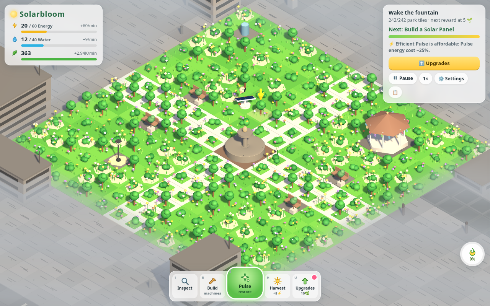
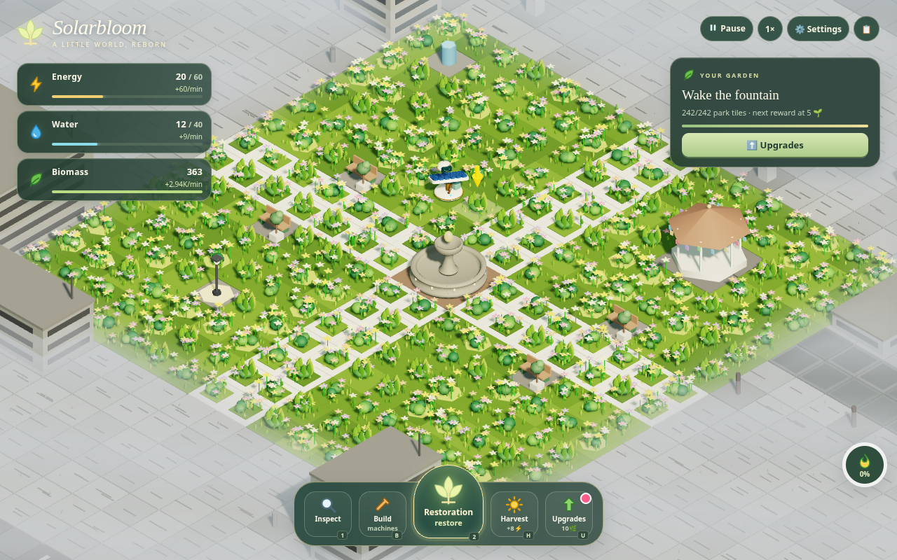
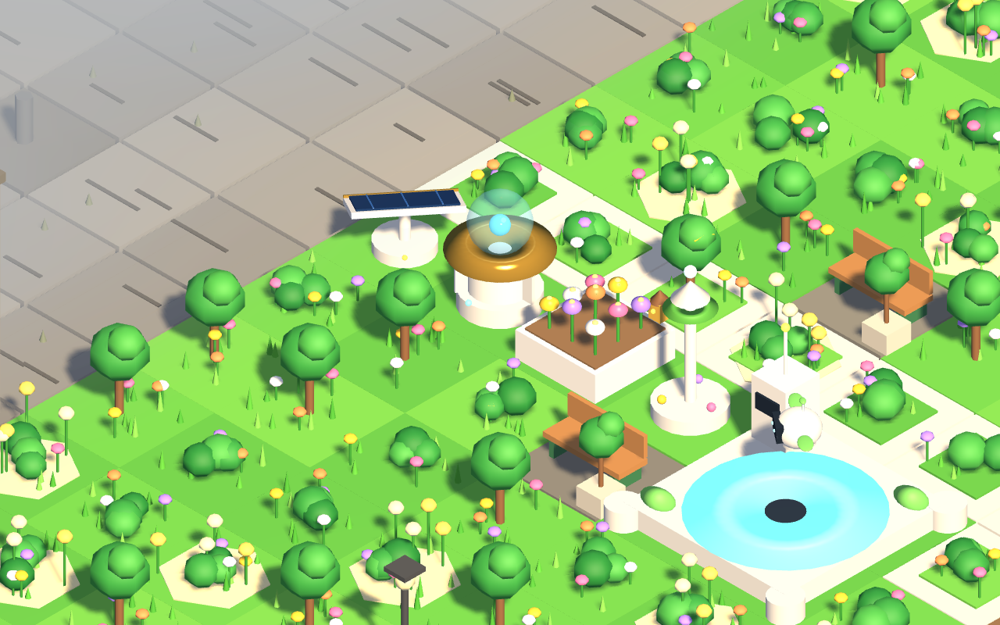
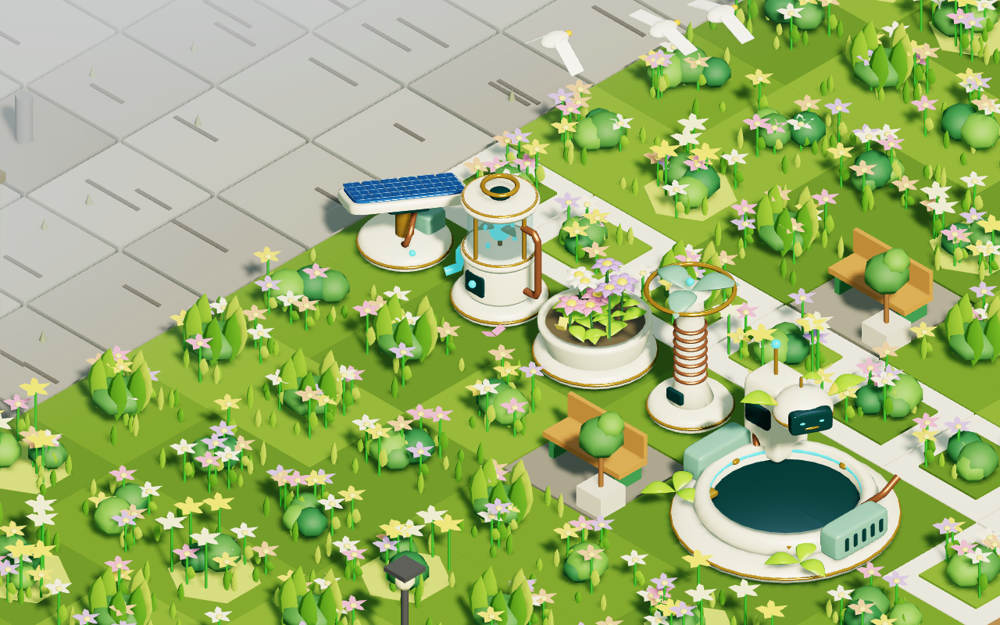
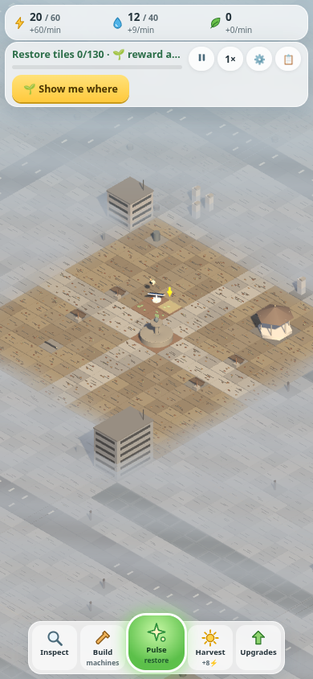
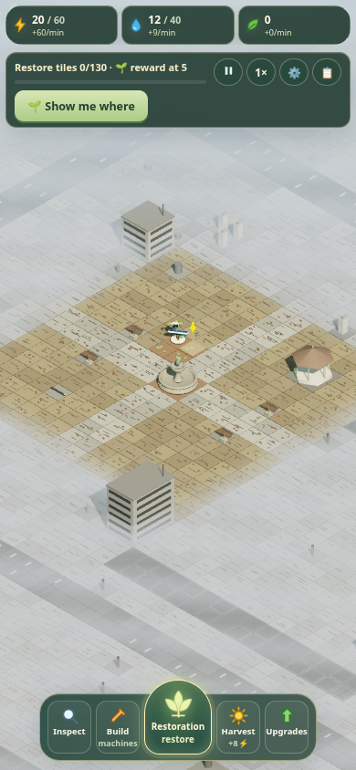
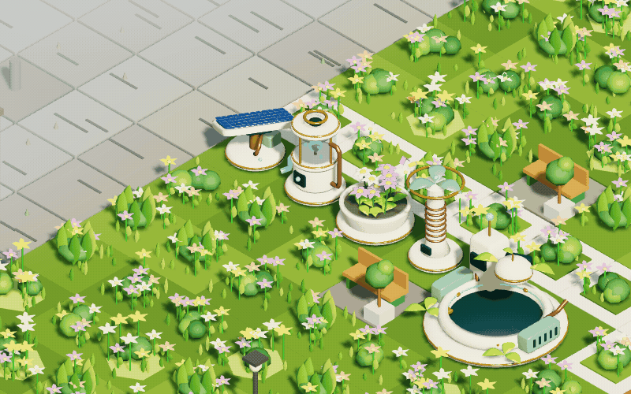

# Solarpunk art overhaul

Starting revision: `68aabaefe46c1abc06cd094684514ec64fad9f8c`, from `ccr-1ec5ff4e-if1699`.

The reference direction is a lush, sunlit solarpunk garden: functioning machines with soft ivory shells, warm metal fittings and botanical details. This is a stylized realtime art implementation, not a reproduction of the reference's offline-rendered fidelity.

## Delivered art

- Ten original glTF assets covering all seven buildable machine types, the drone, fountain and rooftop arch. Visible pipes, cooling vents, charging contacts, solar cells, a condenser rotor and a relay coil keep the technology legible among plants.
- Named model pivots connect to the existing presentation loop: solar deployment and tracking, water circulation, leaf-wing flight, plant unfurling/sway, rotating relay vanes and dock rings. Existing charge/build/bloom animations remain attached to their original state events.
- Curved leaf blades and petal meshes for the streamed city and rooftops; more varied beds, softer radiant patches, cascading facade vines and blossoms.
- Warm daylight and ACES tonemapping; translucent forest-green HUD with cream text, consistent machine SVG icons and a central botanical Pulse control. The objective checklist can expand; phone and landscape layouts retain the original controls.
- Reduced-motion support for the new model deployment animations and moving parts.

## Scope

No edits to economy, generation, progression, resource values, saves, simulation rules or input mappings. `Game.ts` and `main.ts` only change asset-loading/bootstrap behavior. Visuals read existing game state. The review harness uses staged test states solely to render matching before/after frames.

## Render review

`tests/e2e/art-review.mjs` captures desktop/phone fresh and restored gardens, plus machine views using fixed presentation randomness and identical camera placement. It disables automatic rendering between captures to work reliably with software WebGL. It does not change the shipped game.

```sh
npm run build
SHOTS_DIR=docs/review/lush-after node tests/e2e/art-review.mjs
# Point ART_BUILD at a preserved baseline dist to capture the corresponding before images.
ART_BUILD=/path/to/baseline-dist SHOTS_DIR=docs/review/lush-before node tests/e2e/art-review.mjs
node tests/e2e/art-ui.e2e.mjs
```

The browser scripts require Playwright/Chromium, like the existing project screenshot tools. Model authoring source and asset details: [`public/models/README.md`](../public/models/README.md).

## Matched before / after renders

These are renders of the running game, not concept images. The restored garden is a staged test state used on both revisions; starting progression is unchanged.

| Before | After |
| --- | --- |
|  |  |
|  |  |
|  |  |

### Moving machinery



### Validation

- Production build and TypeScript checks pass.
- All 226 existing tests pass (39 files).
- New browser checks verify all ten glTF assets and their animation pivots, model motion, reduced motion, and that visual updates do not mutate simulation state.
- HUD and build tray fit 320×640, 360×740, 390×844, 430×932, 844×390, 820×1180 and 1280×800. Settings, upgrades and tool selection pass.
- Matched before/after capture completes without browser errors.

This pass preserves the existing world layout and isometric camera. The reference's dense architectural dressing and cinematic texture detail remain a direction for further art work; real-device GPU performance has not been profiled here.
