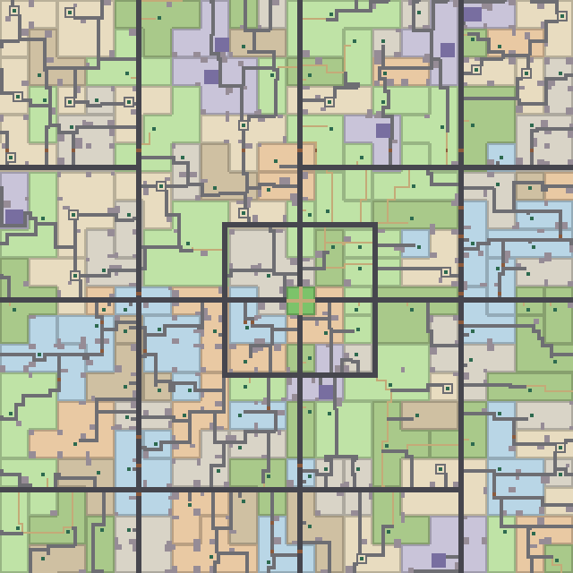

# City 16: road network design (spike, #189)

Roads are planned on the **area graph**, then drawn into tiles one area at a time. Everything is a pure function of the seed, does not depend on evaluation order, and is local: a chunk works out its own road tiles from a bounded neighbourhood of areas. Tuning lives in `CITY_GEN.roads` (`src/data/city.ts`). The plan is in `src/core/RoadPlan.ts`.

*The real network (seed 42), one pixel per two tiles.* Darkest grey is arterials, mid grey is streets, tan is lanes, brown is bridges and light grey is buildings. Dark green squares are landmarks; squares with a ring are plazas. In game: `docs/review/roads-before-overview.png` (generation 3) against `roads-after-overview.png` (generation 4), and a junction dead and restored (`roads-junction-*.png`, from `npm run shots:roads`). In dev builds, `sbDev.roads()` draws the graph over the game: links, gates and the parent tree.

## Hierarchy

| Tier | Width | Surface | Where |
|---|---|---|---|
| Arterial | 3 tiles | asphalt, markings | 4 avenues out of the park, a ring, a district lattice |
| Street | 2 tiles | asphalt | between neighbouring areas, and from each gate to the landmark |
| Lane | 1 tile | paving (footpath) | between two lane-style areas (parkland, grove), and inside them |

### Arterials (16.3)
- **Avenues:** chunk row 0 and column 0, lanes 6–8, from the park's edge outward forever. The park's own 7–8 path cross meets them, so the park sits where the main roads cross.
- **Ring:** a square at 3 chunks (Chebyshev) around the park, on the inner side of its chunks (lanes 0–2 or 12–14). It crosses each avenue.
- **Lattice:** a row and a column every `districtChunks` (6) chunks, each jittered ±1 chunk, on lanes 0–2 or 12–14. That's near a chunk edge, so landmarks keep the middle of the chunk, and clear of the canal rows (3–4), so no arterial runs along a canal. Columns are unbroken. A row segment between two columns is dropped with a 25% chance, so the grid isn't a perfect lattice. Rows always end on a column, so no arterial ends against nothing.
- Every run is straight and pinned to one chunk row or column. A chunk finds its own runs by checking the 3 lattice lines nearest it, without looking at neighbours.
- Where an arterial crosses the border between two areas, **that is their link**: no street is drawn beside it.

### Area links (16.2)
- **Parent link (always):** take the area's chunk nearest the park and step one chunk toward the park along the longer axis. The area that step lands in is the parent, and the link crosses exactly that chunk edge. Every step is strictly closer, so the parent links form a tree rooted at the park, and every area reaches the park by road. This is a stricter version of the issue's "neighbour with the lowest `distance`": `distance` is rounded and can tie, which could make cycles. This rule can't.
- **Extra links (loops):** for each other neighbour pair, a seeded roll against the mean of both themes' `extraChance` (towers 0.55, oldtown 0.45, docks 0.3, parkland 0.15). Each area ranks its candidates by the pair hash and takes extras only while it has fewer than `maxLinks` (4). A pair links only if **both** sides rank each other inside their room, so both agree. Tree and arterial links never count against the cap, so a hub can exceed 4.
- **Gates:** the parent edge for tree links, otherwise a shared chunk edge picked by the pair hash. The tile offset starts from the pair hash and moves to the nearest one whose cells, a road-width deep on both sides, avoid both landmarks and rooftops (and canals, on an east–west crossing). It searches tiles 5–10, then 4–11, then the other shared edges. A→B and B→A return the same gate (tested).
- **One-piece areas (gen 4):** snapping chunk centres to the Voronoi can leave an area's chunks touching only at a corner. In gen 4 the largest piece keeps the id, and a detached piece joins the lowest-id neighbouring area whose main piece it touches. This is still a local, order-independent lookup.
- **Tier:** lane if both areas are lane-style (parkland, grove), otherwise street.

## Routing inside an area (16.4)
Each area routes only inside its own chunks. Its terminals are its gates, every arterial run through it, and its landmark plaza. It connects them with A* over the area's tiles. Existing road is cheap, so later routes join earlier ones and make junctions rather than parallel roads. Each area type's style is a cost shape:

| Style | Area types | Shape |
|---|---|---|
| grid | street, market, rooftops | Manhattan cost with a turn penalty: straight blocks, right-angle junctions |
| ring | plaza | a 1-tile ring round the landmark clearance; gates join the ring |
| curve | park, grove | seeded noise in the cost: gently curving lanes, 1 tile, paved |
| waterside | canal | cheap beside the canal lanes, so a street runs along the water; crossings become bridges |
| skirt | reservoir | expensive near the centre, so roads skirt the basin and end at the cistern from one side |

- **Landmark:** the landmark and one tile round it (a square) are never road. The ring of cells round that is its plaza: the first route ends there, and plazas paint it as a ring. Rooftop clusters keep their whole roof clear and end roads at its edge. In gen 4 the landmark is nudged inside its chunk so it never sits on an arterial lane, and a rooftop cluster that would cover an arterial stays a plain area.
- **Brush:** a 2-wide route paints its centre cell plus the cell beside it across its heading (+z moving along x, +x moving along z), and fills the 2×2 at turns. A route ends as soon as its centre lands on the network, so nothing overhangs past the road it joins.
- **Cul-de-sacs:** allowed only as an area's own road ending at its landmark plaza. Any other dead end is a bug (tested).
- **Pieces:** every road tile records which of its 4 sides continue as road (a mask). The renderer derives straight, corner, T-junction, crossroads and dead end from it, plus kerbs on the sides that don't continue. Classifying 2- and 3-wide roads by single tiles would label every tile a junction, so the piece label is computed on the road's centreline.
- **Bridges:** canals run along x, so a route may only step onto water moving along z. Roads cross canals straight over and never run along them. A road tile on a canal lane stays `feature: 'road'` (walkable, restorable) and is flagged as a bridge by the road lookup, not in `TileData`, so saves don't change. Lanes are `feature: 'paving'`.

## Buildings and rooftops (16.5)
In gen 4, `buildingPlots` keeps one building per quarter of a chunk. It takes the first spot, from the quarter's outer corner inward, that is clear of roads, lanes, canals, the landmark and the roof, and prefers a spot that fronts a road. About 7 in 10 do; the rest are in quarters with no road within reach. Buildings fronting an arterial get a storey more (capped at the theme's maximum + 1). Roads never run under a roof, so rooftops need no nudge.

## Generation 4 and saves (16.7)
`GROUND_GEN` becomes 4. Gens 2–3 keep `roadRow`/`roadCol`/`canalRow` exactly as now (tested). Canals keep their current rows: this epic only adds bridges. Corridors, the Advisor and milestones already read `feature === 'road'`, so they work unchanged on the new layout.

## Performance
Area plans and rasters are cached per seed, like `areaMapFor`. Routing is Dijkstra over cells × heading, using typed arrays over the area's bounding box. It runs once per area, the first time any of its chunks generates. Measured cold: 0.2–0.3 ms per chunk for the roads alone, and about 0.6 ms per chunk for a whole gen-4 chunk with the plan cold (`npm run test:perf`; gens 2–3 run 0.2–0.4 ms).

## Decisions (agreed 2026-11-16)
1. A straight arterial lattice every ~6 chunks (jittered, with some rows dropped).
2. A ring at 3 chunks.
3. The parent rule (one chunk step toward the park) replaces "neighbour with the lowest distance", for a guaranteed tree.
4. Max 4 links per area before extras stop.

## Tests
- `tests/roads.test.ts` (quick): parent tree to the park, symmetric links and gates, order independence, link cap, continuous arterials, no road on landmarks or roofs, gates line up, no isolated tiles or stubs, one network per area.
- `tests/roads-ground.test.ts`: new games are gen 4; no building, roof or obstacle on a road; buildings front streets; gen 2/3 tiles byte-identical to main before City 16 (fingerprints).
- `tests/soak/roads.soak.ts` (`npm run test:soak`): 1,000+ areas over 5 seeds, each reached from the park by walking road tiles; no stubs; gates match; shuffled evaluation order.
- `tests/perf/world.perf.ts` (`npm run test:perf`): gen-4 chunk generation time.
