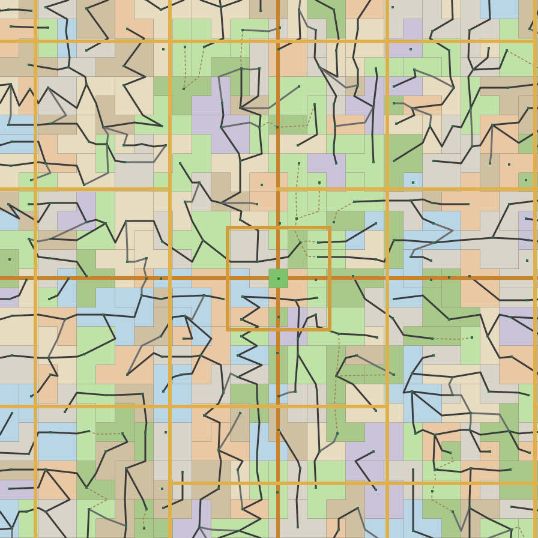

# City 16: road network design (spike, #189)

Roads are planned on the **area graph**, then drawn into tiles one area at a time. Everything is a pure function of the seed, does not depend on evaluation order, and is local: a chunk works out its own road tiles from a bounded neighbourhood of areas. Tuning lives in `CITY_GEN.roads` (`src/data/city.ts`). The plan is in `src/core/RoadPlan.ts`.

*Sketch from the real plan (seed 42).* Orange is arterials at their real tiles: the darkest are the avenues, then the ring, then the lattice. Dark lines are street links drawn landmark → gate → landmark. Grey lines are extra (loop) links. Dashed brown lines are lanes. Small squares are landmarks. The lines show **which** areas connect and **where** they cross the border. The real routes inside each area come in 16.4.

## Hierarchy

| Tier | Width | Surface | Where |
|---|---|---|---|
| Arterial | 3 tiles | asphalt, markings | 4 avenues out of the park, a ring, a district lattice |
| Street | 2 tiles | asphalt | between neighbouring areas, and from each gate to the landmark |
| Lane | 1 tile | paving (footpath) | between two lane-style areas (parkland, grove), and inside them |

### Arterials (16.3)
- **Avenues:** chunk row 0 and column 0, lanes 6–8, from the park's edge outward forever. The park's own 7–8 path cross meets them, so the park sits where the main roads cross.
- **Ring:** a square at 3 chunks (Chebyshev) around the park, on the inner side of its chunks (lanes 1–3 or 12–14). It crosses each avenue.
- **Lattice:** a row and a column every `districtChunks` (6) chunks, each jittered ±1 chunk, on lane 1–3 or 12–14 (near a chunk edge, so landmarks keep the middle of the chunk). Columns are unbroken. A row segment between two columns is dropped with a 25% chance, so the grid isn't a perfect lattice. Rows always end on a column, so no arterial ends against nothing.
- Every run is straight and pinned to one chunk row or column. A chunk finds its own runs by checking the 3 lattice lines nearest it, without looking at neighbours.
- Where an arterial crosses the border between two areas, **that is their link**: no street is drawn beside it.

### Area links (16.2)
- **Parent link (always):** take the area's chunk nearest the park and step one chunk toward the park along the longer axis. The area that step lands in is the parent, and the link crosses exactly that chunk edge. Every step is strictly closer, so the parent links form a tree rooted at the park, and every area reaches the park by road. This is a stricter version of the issue's "neighbour with the lowest `distance`": `distance` is rounded and can tie, which could make cycles. This rule can't.
- **Extra links (loops):** for each other neighbour pair, a seeded roll against the mean of both themes' `extraChance` (towers 0.55, oldtown 0.45, docks 0.3, parkland 0.15). Each area ranks its candidates by the pair hash and takes extras only while it has fewer than `maxLinks` (4). A pair links only if **both** sides rank each other inside their room, so both agree. Tree and arterial links never count against the cap, so a hub can exceed 4.
- **Gates:** the parent edge for tree links, otherwise a shared chunk edge picked by the pair hash. The tile offset comes from the pair hash, within tiles 5–10 of the edge, clear of the arterial lanes near chunk edges. A→B and B→A return the same gate (tested).
- **Tier:** lane if both areas are lane-style (parkland, grove), otherwise street.

## Routing inside an area (16.4)
Each area routes only inside its own chunks. Its terminals are its gates, every arterial run through it, and its landmark plaza. It connects them with A* over the area's tiles. Existing road is cheap, so later routes join earlier ones and make junctions rather than parallel roads. Each area type's style is a cost shape:

| Style | Area types | Shape |
|---|---|---|
| grid | street, market, rooftops | Manhattan cost with a turn penalty: straight blocks, right-angle junctions |
| ring | plaza | a 1-tile ring round the landmark clearance; gates join the ring |
| curve | park, grove | seeded noise in the cost: gently curving lanes, 1 tile, paved |
| waterside | canal | cheap beside the canal lanes, so a street runs along the water; crossings become bridges |
| skirt | reservoir | expensive near the centre, so roads skirt the basin and end at the cistern from one side |

- **Landmark:** the clearance square (`landmarkClearance` = 2) round the 2×2 landmark stays clear. Roads end on its edge (a small plaza) or, for plazas, ring it. In gen 4 the landmark is nudged inside its chunk so it never sits on an arterial lane.
- **Cul-de-sacs:** allowed only as an area's own road ending at its landmark plaza. Any other dead end is a bug (tested).
- **Pieces:** every road tile records which of its 4 sides continue as road (a mask). The renderer derives straight, corner, T-junction, crossroads and dead end from it, plus kerbs on the sides that don't continue. Classifying 2- and 3-wide roads by single tiles would label every tile a junction, so the piece label is computed on the road's centreline.
- **Bridges:** a road tile on a canal lane stays `feature: 'road'` (walkable, restorable) and is flagged as a bridge by the road lookup, not in `TileData`, so saves don't change.

## Buildings and rooftops (16.5)
`buildingPlots` asks the road lookup instead of the hard-coded lanes 7/8. Plots that touch a road shift back by one tile so they front it. Plots along arterials roll `+1` storey. A rooftop cluster that would cover a road shifts within its chunk. If it still can't fit, the area stays a plain street, plaza or market.

## Generation 4 and saves (16.7)
`GROUND_GEN` becomes 4. Gens 2–3 keep `roadRow`/`roadCol`/`canalRow` exactly as now (tested). Canals keep their current rows: this epic only adds bridges. Corridors, the Advisor and milestones already read `feature === 'road'`, so they work unchanged on the new layout.

## Performance
Area plans are cached per seed, like `areaMapFor`. The A* for one area runs over at most ~9 chunks (≈2,300 tiles), once per area, the first time any of its chunks generates. The target is <1 ms per chunk on average (benchmark in 16.8).

## Decisions for the owner
1. A straight arterial lattice every ~6 chunks (jittered, with some rows dropped). The alternative is curving arterials that wander between lattice nodes, which costs more and is harder to keep local.
2. A ring at 3 chunks. A larger ring (5–6) is possible but would cross the first lattice lines.
3. The parent rule replaces "neighbour with the lowest distance", for a guaranteed tree.
4. Max 4 links per area before extras stop.
